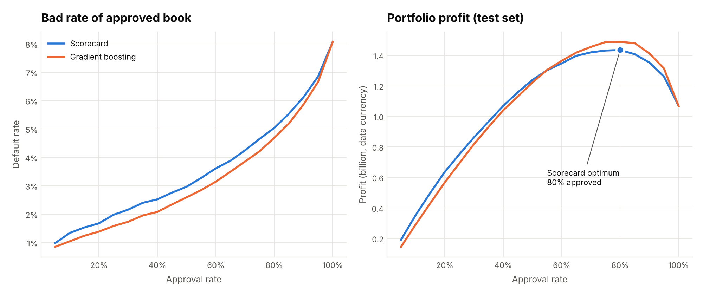
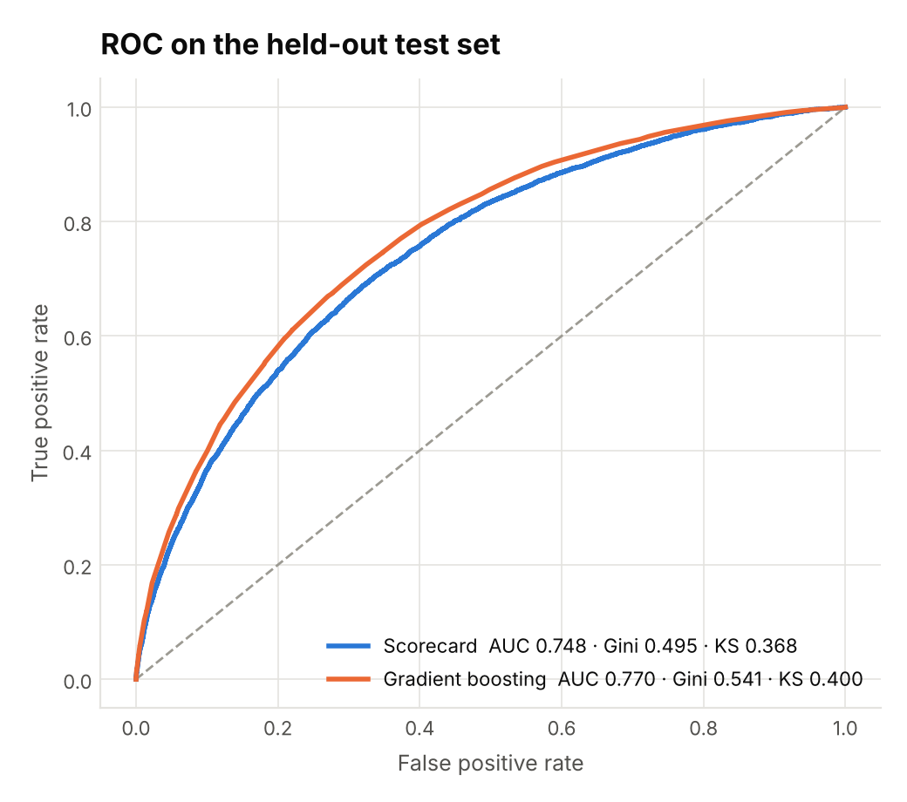
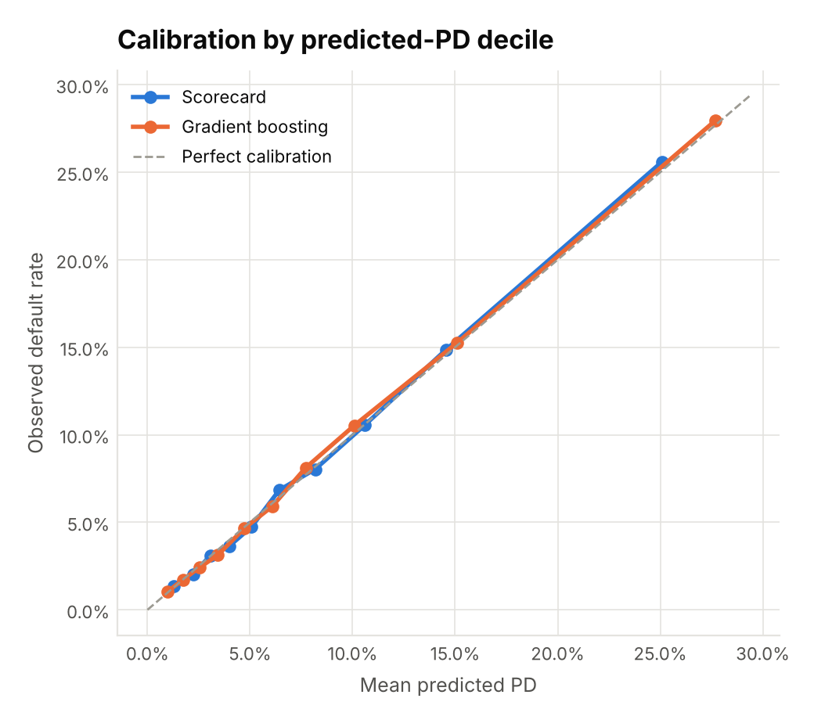
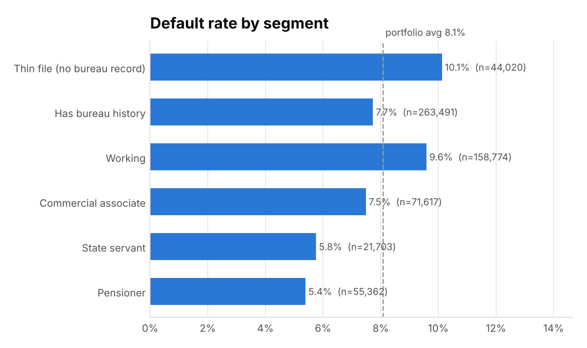

# Home Credit Risk Scorecard & Cut-off Strategy

Who should a consumer lender approve? This project builds a **credit-risk scorecard** on the Home Credit Default Risk data (307,511 loans, 1.7M credit-bureau records). It sets it against a **gradient-boosting challenger**, tests which customer segments default more often, and turns the model into a **profit-maximising approval cut-off** with an editable Excel model and a 5-slide recommendation deck.

**Headline:** approving the best-scoring **80%** of applicants (score ≥ 544) cuts the approved book's bad rate from **8.1% to 5.0%** and declines **50%** of defaulters. Under the stated loss and margin assumptions it raises portfolio profit by **34%** over approving everyone.



## Results (held-out test set, 61,503 loans)

| Metric | WoE scorecard | Gradient boosting (calibrated) |
|---|---|---|
| AUC | 0.748 | **0.770** |
| Gini | 0.495 | **0.541** |
| KS | 0.368 | **0.400** |
| Calibration error (ECE) | 0.24% | 0.20% |
| Inputs | 19 characteristics, points per bin | 52 features |

- A paired bootstrap (300 resamples) puts boosting's AUC gain at **+0.023 (95% CI 0.019 to 0.027)**, so the gap is real.
- At the same 80% approval rate, boosting earns **3.7% more profit** (bad rate 4.7%).
- The recommendation is to deploy the explainable scorecard and run boosting as a challenger until its explanations pass model-risk review.
- Boosting's train AUC (0.852) is well above its test AUC (0.770). Early stopping limits that overfit; all figures here are test-set figures.

| ROC | Calibration |
|---|---|
|  |  |

### Hypothesis tests (full portfolio)

| Question | Test | Result |
|---|---|---|
| Do thin-file applicants (no bureau record) default more? | two-proportion z-test | **10.1% vs 7.7%**, z = 17.1, p < 0.001, 95% CI of difference 2.1–2.7 pts. They are 31% riskier. |
| Do cash loans default more than revolving loans? | two-proportion z-test | 8.3% vs 5.5%, z = 17.1, p < 0.001 |
| Is default independent of education? | chi-square | rejected (p < 0.001), but Cramér's V = 0.058: significant yet small |
| Is default independent of income type? | chi-square | rejected (p < 0.001), Cramér's V = 0.064 |

With 307K rows almost any difference is "significant", so the effect sizes (relative risk, Cramér's V) carry the business meaning.



## What's in the pipeline

1. **SQL feature engineering** (`sql/`, standard SQL that runs on SQLite or PostgreSQL)
   - Bureau history is aggregated to one row per applicant: active share, utilisation, current and historic overdue amounts, loans opened in the last year, history length.
   - That table is joined to the application table, with affordability ratios: credit/income, annuity/income, credit/goods.
   - The `DAYS_EMPLOYED = 365243` placeholder becomes NULL plus a flag.
   - `CODE_GENDER` is deliberately excluded, because gender is a protected attribute.
2. **WoE / IV scorecard** (`woe.py`, `scorecard.py`)
   - Quantile bins with at least 5% of applicants each, merged until the bad rate is monotonic. Missing values get their own bin.
   - IV filter keeps 0.02 ≤ IV < 0.5. A correlation filter drops the weaker of any pair with |r| > 0.7.
   - Logistic regression with a sign check: every WoE coefficient must be negative.
   - Scaled to points: 600 = 50:1 odds, 20 points to double the odds.
   - Outputs a points-per-bin table and **reason codes** (the characteristics that cost an applicant the most points).
3. **Challenger** (`gbm.py`)
   - scikit-learn `HistGradientBoostingClassifier` (the LightGBM family) with native categoricals and early stopping.
   - Isotonic calibration fitted on the validation split only.
   - Permutation importance.
4. **Evaluation** (`metrics.py`): AUC, Gini, KS, Brier, calibration error, risk deciles with lift and capture, and a paired bootstrap of the AUC difference.
5. **Cut-off strategy** (`strategy.py`)
   - Rank applicants best-first and approve down to each approval rate.
   - Expected loss = LGD × exposure of defaulted loans.
   - Revenue = net margin × exposure of repaid loans.
   - Profit = revenue − expected loss.
6. **Deliverables**
   - `reports/cutoff_strategy_model.xlsx`: a **live-formula Excel / Google Sheets model**. Change LGD or margin on the Inputs sheet and every profit figure and the optimal cut-off recalculate (INDEX/MATCH).
   - `reports/credit_risk_recommendation.pptx`: a 5-slide deck for a non-technical manager.
   - `reports/powerbi/` plus [`docs/POWERBI.md`](docs/POWERBI.md): CSVs, DAX measures and the layout for a one-page Power BI dashboard.

## Run it

Data is not committed. Download it from [kaggle.com/c/home-credit-default-risk](https://www.kaggle.com/c/home-credit-default-risk/data): `application_train.csv` and `bureau.csv`, into `data/`.

```bash
pip install -r requirements.txt
PYTHONPATH=src python -m creditrisk.pipeline --data-dir data --out-dir reports   # ~2 min on a laptop
pytest -q                                                                        # 15 tests, synthetic data, no download needed

# deck (optional, needs Node)
npm install pptxgenjs && node scripts/build_deck.js reports

# LightGBM + SHAP variant (optional)
pip install lightgbm shap && PYTHONPATH=src python scripts/optional_lightgbm_shap.py
```

The test suite runs the full pipeline end to end on synthetic data shaped like Home Credit, so CI needs no download. The suite checks:
- the SQL aggregates against pandas;
- that the integer-division guard works;
- WoE against a hand calculation;
- that bins are monotonic;
- that scorecard points add up to the model's own score;
- reason codes, z² = uncorrected χ², and the cut-off economics.

## Limitations

- **No reject inference.** The data contains only loans that were granted, so declined applicants' outcomes are unknown and the cut-off is tuned on an already-filtered population.
- **No out-of-time test.** The dataset has no application dates, so the split is random and stratified. A production model would be validated on a later time window.
- **LGD (60%) and net margin (8%) are working assumptions**, not lender data. The optimal cut-off moves with them, which is why the Excel model exposes them as inputs.
- Amounts are in the dataset's own currency units (the dataset does not name the currency).
- `EXT_SOURCE_1/2/3` are anonymised external scores and are the strongest predictors. Their provenance would need checking before production use.

## Repository layout

```
sql/                 bureau aggregation, model feature table, portfolio views
src/creditrisk/      db, woe, scorecard, gbm, metrics, stats_tests, strategy, reports, pipeline
tests/               unit tests + end-to-end pipeline test on synthetic data
scripts/             deck builder (pptxgenjs), optional LightGBM + SHAP
reports/             figures, Excel model, deck, CSV outputs, Power BI exports
docs/POWERBI.md      dashboard build guide
```
